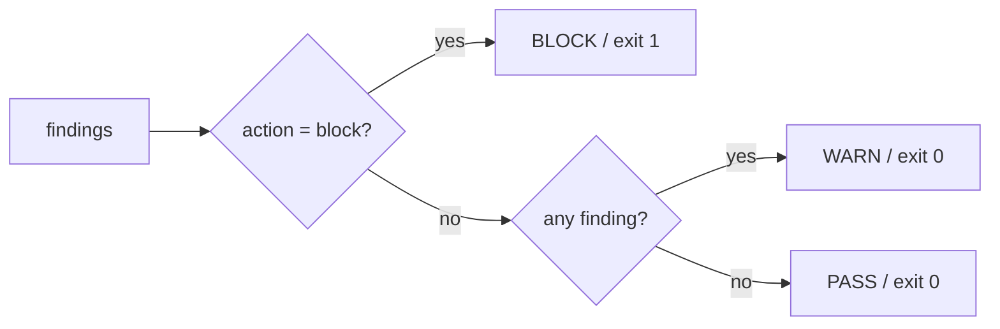

# keur

Deterministic guardrails for AI-generated code.

keur is a single compiled C++ binary that runs as a git pre-commit / pre-push
gate. On commit or push it reads the staged files, runs a native RE2 rule engine
over them, normalises the matches into findings, and a policy engine decides
PASS, WARN, or BLOCK. Findings are evidence. The policy engine is the referee.

The core rule, never broken:

```text
staged files -> rule engine -> findings -> deterministic policy -> PASS / WARN / BLOCK
```

The rule engine uses RE2 (Google's regex library), which is linear-time and has
no catastrophic backtracking. Same input, same rules, same verdict, every time.
See `docs/adr/` for the decisions behind the design.

## Why C++

An earlier shell prototype was correct but too slow for a hook: spawning a
process per rule took minutes over a large rule corpus. The compiled engine
scans the same corpus in well under a second. A single binary also means one
artifact to distribute and no runtime language dependency. See
`docs/adr/ADR-001-native-rule-engine.md` and
`docs/adr/ADR-002-single-cpp-binary.md`.

## Build

The binary is built from `src/keur`. It depends on RE2 and abseil.

```bash
# macOS
brew install re2 abseil

# Debian / Ubuntu
sudo apt install libre2-dev libabsl-dev
```

Build:

```bash
cd src/keur
make            # produces ../../bin/keur
```

The Makefile resolves RE2 and abseil via `brew --prefix` on macOS and falls back
to system include/lib paths on Linux. The version string is read from
`config/keur.toml` at build time and baked in as `KEUR_VERSION`.

Install the binary on your PATH so the hook stubs can find it:

```bash
install -m 755 bin/keur /usr/local/bin/keur
```

## Subcommands

```text
keur hook   [--install | --global | --status | --remove [--global]]
keur scan   [path]
keur check  [--tier pre-commit|pre-push] [--ai off] [--config <file>]
keur policy explain
keur version
keur help
```

### hook

Manages the git hook stubs. The stubs are one-line shell files that do nothing
but `exec keur check`. git requires hooks to be executable scripts, so the stub
is shell, but no logic lives in it.

```bash
keur hook --install          # write pre-commit + pre-push into .git/hooks
keur hook --global           # write into the global hooks dir and set
                             # core.hooksPath for every repo on the machine
keur hook --status           # show which hooks are active (global + repo)
keur hook --remove           # remove the per-repo stubs
keur hook --remove --global  # remove the global stubs
```

Per-repo install resolves the hooks directory via `git rev-parse --git-dir` so a
global `core.hooksPath` does not redirect it. Global install targets
`$XDG_CONFIG_HOME/git/hooks` (default `~/.config/git/hooks`). If
`core.hooksPath` is already set to a different directory, keur leaves it
unchanged and tells you.

The generated stubs are:

```sh
#!/bin/sh
exec keur check --tier pre-commit    # (pre-push stub uses --tier pre-push)
```

### scan

Runs the rule engine over a directory (or file) and prints findings as JSONL to
stdout, one JSON object per line. scan never blocks. It is for ad-hoc and
full-repo inspection. Use `keur check` when you want a verdict.

```bash
keur scan            # scan the current directory
keur scan src/       # scan a subtree
keur scan --json .   # force JSON output
```

Each finding line has this shape:

```json
{"source":"keur-rules","rule":"KEUR-SEC-001","title":"...","category":"secret","severity":"critical","action":"block","confidence":0.98,"deterministic":true,"file":"...","line":12,"message":"..."}
```

scan reports the number of findings to stderr so stdout stays clean for piping.

### check

The gate. This is what the hooks call. It asks git for the staged files
(added, copied, modified), loads the rules, scans the staged files in-process,
and applies the policy.

```bash
keur check                      # tier pre-commit (default)
keur check --tier pre-push      # tier pre-push
keur check --ai off             # AI escalation flag (parsed; default off)
keur check --config keur.toml   # explicit config path
```

Exit code: `0` for PASS or WARN, `1` for BLOCK. When nothing is staged, check
prints a PASS and exits `0`. Progress and the verdict are printed to stderr.

### policy explain

Prints the resolved policy: which config file was used and the effective
thresholds.

```bash
keur policy explain
```

Output:

```text
keur policy (resolved from: /path/to/keur.toml)

  version  : 0.1.0
  block-at : 0.85  (findings with action=block and confidence >= this value block the commit)
  warn-at  : 0.50  (findings at or above this confidence level emit a warning)

To override: set block-at / warn-at in /path/to/keur.toml
```

### version

Prints the version. It prefers the `version` value from the resolved
`keur.toml`; if that is unset it falls back to the compile-time `KEUR_VERSION`.

```bash
keur version
keur --version
keur -v
```

## How keur decides PASS / WARN / BLOCK

The verdict is a pure function of the findings the rule engine produces. In
`keur check`, each finding contributes to three boolean signals: any finding at
all, a blocking secret, or a blocking rule. The policy is:

```text
any finding with action = block   -> BLOCK   (exit 1)
otherwise, any finding at all      -> WARN    (exit 0)
otherwise                          -> PASS    (exit 0)
```

Each rule carries an `action` (`block`, `warn`, or `advisory`) and a
`confidence`. The thresholds `block-at` and `warn-at` in `keur.toml` define how
calibrated confidence maps to a verdict. `keur policy explain` prints the
resolved values.



## Configuration

`keur.toml` holds the policy thresholds, the per-tier scanner lists, and the
tool inventory. Resolution order (later overrides earlier):

1. built-in defaults
2. global: `$XDG_CONFIG_HOME/keur/keur.toml`
3. `$KEUR_HOME/config/keur.toml` (installed location)
4. an explicit `--config <file>`

An explicit `--config` path always wins. See `config/keur.toml` for the full,
documented set of defaults.

## Rules and custom rule directories

Rules are `.rule` files (cpm-compatible format) grouped by category under
`rules/` (for example `security/`, `secrets/`, `pii/`, `quality/`, and the
self-check `keur-internal/`). The engine supports the `pattern`, `presence`, and
`absence` engines, which cover almost the whole corpus. Unsupported engine types
are reported rather than silently skipped.

keur resolves rule directories from two environment variables:

1. `$KEUR_HOME/rules`
2. every colon-separated entry in `$KEUR_RULES_DIRS`

To add your own rules without touching the built-in set:

```bash
export KEUR_RULES_DIRS="$HOME/my-keur-rules:/team/shared-rules"
keur scan .
```

Because the `.rule` format is cpm-compatible, an existing cpm rule corpus can be
reused by pointing `KEUR_RULES_DIRS` at it.

Inline suppression uses the marker `keur:ignore [<rule-id|category>]` in a
comment on the offending line. Matching is token-exact, so `SEC-04` does not
suppress `SEC-043`.

## Documentation

- `docs/c4.md` - C4 context, container, and component views
- `docs/dataflow.md` - staged files to verdict data flow
- `docs/diagrams.md` - class diagram and sequence diagrams
- `docs/adr/ADR-001-native-rule-engine.md` - why a native RE2 engine
- `docs/adr/ADR-002-single-cpp-binary.md` - why one compiled binary
- `docs/adr/ADR-003-provider-architecture.md` - the adapter / provider layers
- `CONTRIBUTING.md` - build, test, coverage, mutation, layout, self-checks

## License

See `LICENSE`.
