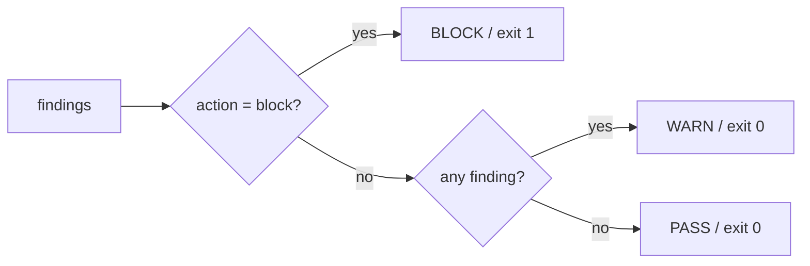

# keur

Deterministic guardrails for AI-generated code — an **anti-slop, vibe-code
limiter** that runs as a git pre-commit hook.

> Looking for: AI code guardrails · vibe-coding limiter · anti-slop · AI/LLM
> pre-commit gate · shift-left security hook · secret & hardening scanning ·
> deterministic policy-as-code. That's keur.

keur is a single compiled C++ binary that runs as a git pre-commit / pre-push
gate. On commit or push it reads the staged files, runs a native RE2 rule engine
over them, normalises the matches into findings, and a policy engine decides
PASS, WARN, or BLOCK. Findings are evidence. The policy engine is the referee.

The core rule, never broken:

```text
staged files -> rule engine -> findings -> deterministic policy -> PASS / WARN / BLOCK
```

The rule engine uses RE2 (Google's regex library), which is linear-time and has
no catastrophic backtracking. Same input, same rules, same verdict, every time.
See `docs/adr/` for the decisions behind the design.

## More than a hook

That gate is the core, but keur grows on top of it into a **profile-driven,
standards-grounded guardrail — a copilot for coding and vibe-coding**:

- A **project profile** (`owner`, `lifecycle`, `criticality`, `maturity`, `docs`)
  decides what blocks vs. warns — a prototype and a mission-critical service run
  the same hook but are held to different bars. → `docs/adr/ADR-011-project-profile.md`
- **Security & hardening by rules on known patterns**, with autodetection of
  platform / framework / runtime. → `docs/adr/ADR-009-composite-rules-and-facts.md`
- **Clear errors** so a human *or an AI* knows exactly what to fix — no reaching
  for `--no-verify`.
- **Traceability** (`@id` / `@implements` / `@proves`, IDE-clickable) and
  **pipeline coverage** (which CI stages a repo has vs. needs).
  → `docs/adr/ADR-010-traceability.md`, `docs/adr/ADR-012-pipeline-coverage.md`
- **Learns on your own codebase** with a local LLM — **your IP never leaves your
  machine**. → `docs/design/learning-loop.md`

keur is **MIT-licensed and free**. It wraps open-source tools; paying it forward
is welcome but never required — a good rule (merge request), a donation, or the
wishlist. The full picture: **`docs/design/vision.md`**.

## Why C++

A pre-commit hook runs on every commit, so it must be **sub-second** — slow it
down and people disable it. An earlier shell prototype was correct but too slow:
spawning a process per rule took minutes over a large rule corpus. The compiled
engine scans the same corpus in well under a second. A single binary also means
one artifact to distribute and no runtime language dependency. See
`docs/adr/ADR-001-native-rule-engine.md` and
`docs/adr/ADR-002-single-cpp-binary.md`.

## Build

The binary is built from `src/keur`. It depends on RE2 and abseil.

```bash
# macOS
brew install re2 abseil

# Debian / Ubuntu
sudo apt install libre2-dev libabsl-dev

# Windows (MSYS2 UCRT64 shell)
pacman -S make mingw-w64-ucrt-x86_64-gcc \
          mingw-w64-ucrt-x86_64-re2 mingw-w64-ucrt-x86_64-abseil-cpp
```

Build:

```bash
cd src/keur
make            # produces ../../bin/keur  (keur.exe on Windows)
```

keur builds on macOS, Linux and Windows. OS-divergent code lives behind a
platform abstraction layer (`src/keur/common/platform.*`); the Makefile selects
`platform_posix.cpp` or `platform_win32.cpp` per OS, and business code holds no
`#ifdef`. The `KEUR-PORT-*` self-check rules block platform drift, and CI
(`.github/workflows/ci.yml`) builds + smoke-tests all three OSes on every push.
See `docs/adr/ADR-005-platform-abstraction.md`.

The Makefile resolves RE2 and abseil via `brew --prefix` on macOS and falls back
to system include/lib paths on Linux. The version string is read from
`config/keur.toml` at build time and baked in as `KEUR_VERSION`.

Install the binary on your PATH so the hook stubs can find it:

```bash
install -m 755 bin/keur /usr/local/bin/keur
```

## Subcommands

```text
keur hook   [--install | --global | --status | --remove [--global]]
keur scan   [path]
keur check  [--tier pre-commit|pre-push] [--ai off] [--config <file>]
keur train  [--source corpus|keureval|alternate] [--model <name>]
            [--status | --stop | --no-spin | --refresh <sec>]
keur policy explain
keur version
keur help
```

### hook

Manages the git hook stubs. The stubs are one-line shell files that do nothing
but `exec keur check`. git requires hooks to be executable scripts, so the stub
is shell, but no logic lives in it.

```bash
keur hook --install          # write pre-commit + pre-push into .git/hooks
keur hook --global           # write into the global hooks dir and set
                             # core.hooksPath for every repo on the machine
keur hook --status           # show which hooks are active (global + repo)
keur hook --remove           # remove the per-repo stubs
keur hook --remove --global  # remove the global stubs
```

Per-repo install resolves the hooks directory via `git rev-parse --git-dir` so a
global `core.hooksPath` does not redirect it. Global install targets
`$XDG_CONFIG_HOME/git/hooks` (default `~/.config/git/hooks`). If
`core.hooksPath` is already set to a different directory, keur leaves it
unchanged and tells you.

The generated stubs are:

```sh
#!/bin/sh
exec keur check --tier pre-commit    # (pre-push stub uses --tier pre-push)
```

### scan

Runs the rule engine over a directory (or file) and prints findings as JSONL to
stdout, one JSON object per line. scan never blocks. It is for ad-hoc and
full-repo inspection. Use `keur check` when you want a verdict.

```bash
keur scan            # scan the current directory
keur scan src/       # scan a subtree
keur scan --json .   # force JSON output
```

Each finding line has this shape:

```json
{"source":"keur-rules","rule":"KEUR-SEC-001","title":"...","category":"secret","severity":"critical","action":"block","confidence":0.98,"deterministic":true,"file":"...","line":12,"message":"..."}
```

scan reports the number of findings to stderr so stdout stays clean for piping.

### check

The gate. This is what the hooks call. It asks git for the staged files
(added, copied, modified), loads the rules, scans the staged files in-process,
and applies the policy.

```bash
keur check                      # tier pre-commit (default)
keur check --tier pre-push      # tier pre-push
keur check --ai off             # AI escalation flag (parsed; default off)
keur check --config keur.toml   # explicit config path
```

Exit code: `0` for PASS or WARN, `1` for BLOCK. When nothing is staged, check
prints a PASS and exits `0`. Progress and the verdict are printed to stderr.

### train

> `keur learn` is a **deprecated alias** for `keur train` (ADR-036): the loop
> *trains keur*, not the user. It still works — it prints a notice and forwards
> to `keur train` — but switch your scripts to `train`.

Trains keur's own rule set. Where `check` and `scan` *apply* rules, `train`
*produces* them: it runs a self-improving loop that grows `rules/learned/`
against a benchmark, so the detector gets better over time without you
hand-writing every rule.

```bash
ollama create keur-rule-engineer -f eval/Modelfile   # one-time: build the primed model
keur train --source alternate                         # start training (auto-uses the primed model)
keur train --status                                   # dashboard only, no loop
keur train --stop                                     # end the background loop
```

Use the expertise-primed `keur-rule-engineer` model (see below): it is built to
write generalising regexes instead of memorising literals from the example,
which is exactly what the acceptance gate rejects as `overfit-regex`. Passing a
raw base model via `--model` (e.g. `--model qwen2.5-coder:14b`) works but tends
to produce more overfit proposals that the gate throws away.

The loop, one iteration at a time:

1. **Measure** keur's rule engine against a ground truth (recall / precision)
   and find the false negatives — the findings keur currently misses.
2. **Propose**: hand the dominant missed case to a local LLM (via Ollama) and
   ask for the *smallest* `.rule` that would catch it.
3. **Gate**: re-measure with the candidate added and accept it only if the
   benchmark improves — recall rises, precision stays above the floor
   (`KEUR_MIN_PRECISION`, default 0.50), and the regex generalises rather than
   memorising a literal from the example. The benchmark decides, never the LLM.
4. Accepted rules are written to `rules/learned/`; every decision is appended to
   `eval/history/optimiser.jsonl`.

`--source` picks the training signal: `corpus` (proven-tool ground truth,
recall-focused), `keureval` (the keur-eval contract, which scores false
positives so noise is punished), or `alternate` — flip between the two each
phase so one run sharpens both recall and precision. `--model` selects the
Ollama model (omit it to use the loop's default, preferring the
expertise-primed `keur-rule-engineer` from `eval/Modelfile` when present).

Optional, one-time: build the primed model. `eval/Modelfile` derives
`keur-rule-engineer` from a base coder model and bakes rule-engineering
expertise (RE2 limits, the `.rule` format, generalise-don't-memorise) into its
SYSTEM prompt, so every call in the loop carries it. Build it once, then let the
loop pick it up automatically (omit `--model`):

```bash
ollama create keur-rule-engineer -f eval/Modelfile
keur train --source alternate            # auto-uses keur-rule-engineer if built
```

To prime a different base model, edit the `FROM` line in `eval/Modelfile`
before `ollama create`. Passing `--model <name>` always overrides this and uses
the named model as-is (unprimed).

`train` runs the loop as a supervised background job (`eval/supervise.sh`) and
opens a live monitor in the foreground; the loop keeps running after you close
the monitor, until `keur train --stop`. Watch progress any time with
`eval/progress.sh` (add `watch` for a refreshing view).

Training on your own signal: because the ground truth is source-agnostic
(one Finding JSON shape per line) and rules resolve from `$KEUR_RULES_DIRS`, you
can point the loop at your own corpus and grow a rule set for your codebase.
See `docs/design/learning-loop.md` for the full pipeline and the scripts under
`eval/`.

### policy explain

Prints the resolved policy: which config file was used and the effective
thresholds.

```bash
keur policy explain
```

Output:

```text
keur policy (resolved from: /path/to/keur.toml)

  version  : 0.1.0
  block-at : 0.85  (findings with action=block and confidence >= this value block the commit)
  warn-at  : 0.50  (findings at or above this confidence level emit a warning)

To override: set block-at / warn-at in /path/to/keur.toml
```

### version

Prints the version. It prefers the `version` value from the resolved
`keur.toml`; if that is unset it falls back to the compile-time `KEUR_VERSION`.

```bash
keur version
keur --version
keur -v
```

## How keur decides PASS / WARN / BLOCK

The verdict is a pure function of the findings the rule engine produces. In
`keur check`, each finding contributes to three boolean signals: any finding at
all, a blocking secret, or a blocking rule. The policy is:

```text
any finding with action = block   -> BLOCK   (exit 1)
otherwise, any finding at all      -> WARN    (exit 0)
otherwise                          -> PASS    (exit 0)
```

Each rule carries an `action` (`block`, `warn`, or `advisory`) and a
`confidence`. The thresholds `block-at` and `warn-at` in `keur.toml` define how
calibrated confidence maps to a verdict. `keur policy explain` prints the
resolved values.



## Configuration

`keur.toml` holds the policy thresholds, the per-tier scanner lists, and the
tool inventory. Resolution order (later overrides earlier):

1. built-in defaults
2. global: `$XDG_CONFIG_HOME/keur/keur.toml`
3. `$KEUR_HOME/config/keur.toml` (installed location)
4. an explicit `--config <file>`

An explicit `--config` path always wins. See `config/keur.toml` for the full,
documented set of defaults.

## Rules and custom rule directories

Rules are `.rule` files (cpm-compatible format) grouped by category under
`rules/` (for example `security/`, `secrets/`, `pii/`, `quality/`, and the
self-check `keur-internal/`). The engine supports the `pattern`, `presence`, and
`absence` engines, which cover almost the whole corpus. Unsupported engine types
are reported rather than silently skipped.

keur resolves rule directories from two environment variables:

1. `$KEUR_HOME/rules`
2. every colon-separated entry in `$KEUR_RULES_DIRS`

To add your own rules without touching the built-in set:

```bash
export KEUR_RULES_DIRS="$HOME/my-keur-rules:/team/shared-rules"
keur scan .
```

Because the `.rule` format is cpm-compatible, an existing cpm rule corpus can be
reused by pointing `KEUR_RULES_DIRS` at it.

Inline suppression uses the marker `keur:ignore [<rule-id|category>]` in a
comment on the offending line. Matching is token-exact, so `SEC-04` does not
suppress `SEC-043`.

## Documentation

Start with the big picture, then dive into the decisions:

- **`docs/design/vision.md`** - the whole picture: from hook to copilot
- `docs/design/traceability.md` - the `@id` / `@implements` / `@proves` convention
- `docs/design/learning-loop.md` - how `keur learn` trains the rule set on your code
- `docs/c4.md`, `docs/dataflow.md`, `docs/diagrams.md` - architecture views

Decisions (ADRs) — the *why* behind each part:

- `docs/adr/ADR-001..003` - native RE2 engine, single binary, provider/adapter layers
- `docs/adr/ADR-004` - staged path to language-agnostic analysis
- `docs/adr/ADR-005..006` - cross-platform build, 32/64-bit portability
- `docs/adr/ADR-007` - pattern-level `exclude` (RE2-friendly "pattern-not")
- `docs/adr/ADR-008` - incremental compile / build-affected
- `docs/adr/ADR-009` - composite rules & the fact-driven engine
- `docs/adr/ADR-010` - lightweight traceability (`@id`/`@implements`/`@proves`)
- `docs/adr/ADR-011` - project profile (owner, lifecycle, criticality, maturity, docs)
- `docs/adr/ADR-012` - pipeline coverage (which CI/CD stages a project needs)
- `docs/adr/ADR-013` - OWASP SAMM coverage & parked gaps
- `CONTRIBUTING.md` - build, test, coverage, mutation, layout, self-checks

## License

See `LICENSE`.
