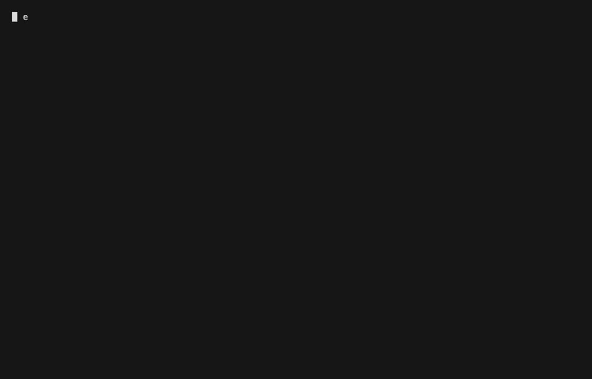

# keur demos

Short, scripted terminal recordings of keur in action. Each demo is a
[vhs](https://github.com/charmbracelet/vhs) `.tape` (the source of truth) rendered
to a GIF. Tapes carry a `@shows <id>` marker naming the concept(s) they
demonstrate, so demo coverage is measurable alongside code and test coverage
(ADR-047).

## Rendering

```sh
vhs demos/<name>.tape          # renders demos/<name>.gif
```

Dependencies: `vhs`, `ttyd`, `ffmpeg` (all via Homebrew).

## Demos

| Demo | Shows | Recording |
|------|-------|-----------|
| [global-hooks-block](global-hooks-block.tape) | `SEC-100`, `KEUR-SECRET-003` — the global pre-commit hook blocks a `.env` with a plaintext secret |  |

## Adding a demo

1. Write `demos/<name>.tape`. Keep it short: use `Hide`/`Show` to skip setup and
   trim `Sleep` so a wait becomes a second or two, not real time.
2. Add a `@shows <concept-id>` marker (a rule id, an `engine-*` id, or an ADR) so
   the demo links to what it demonstrates. One or more ids, space-separated.
3. Render: `vhs demos/<name>.tape`.
4. Add a row to the table above.

`eval/doc-coverage.sh` reports the `concept -> demo` axis from the `@shows` tags.
