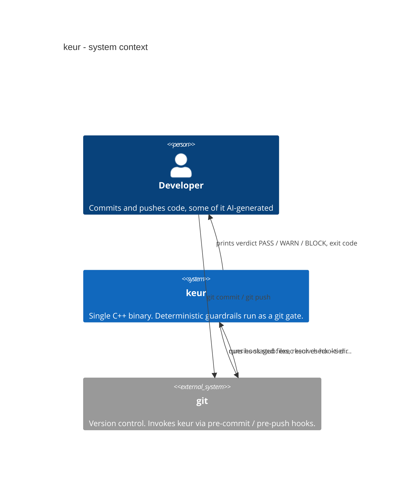
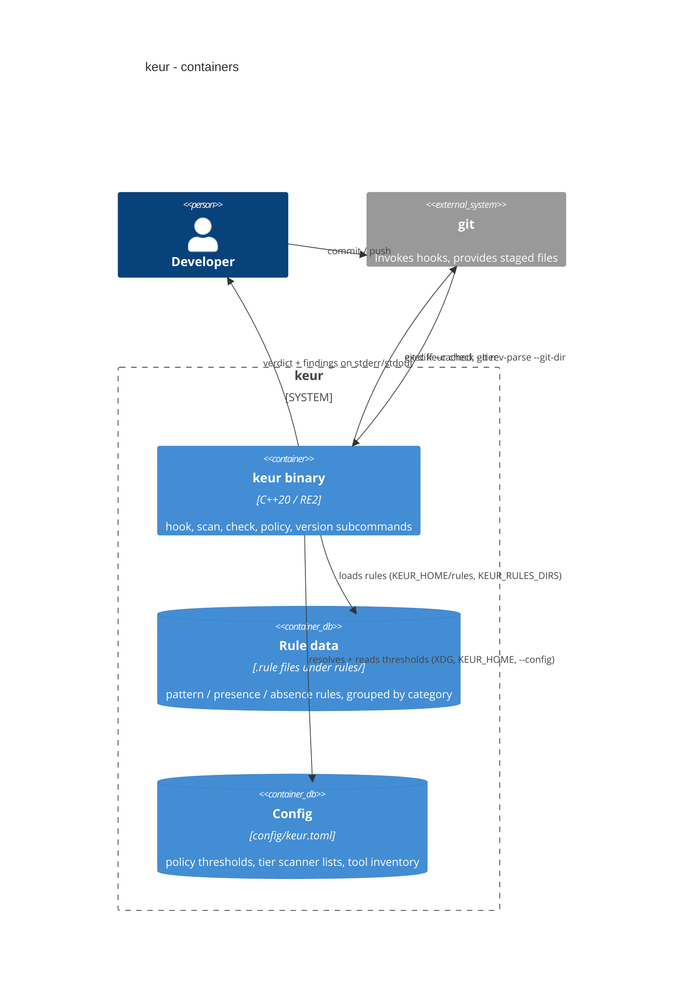
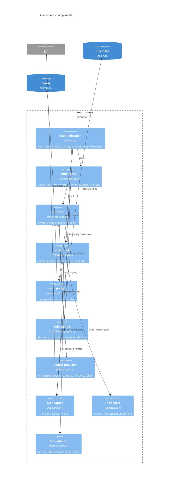

# C4 model

The C4 views below describe keur as it is built: a single compiled binary
(`bin/keur`) invoked by git hooks, reading rule data and config, deciding a
verdict over staged files. Grounded in `src/keur/main.cpp`, `src/keur/cmd/*`,
`src/keur/adapters/*`, `src/keur/report/report.*`, `src/rules/rule_engine.*`,
and `config/keur.toml`.

## Level 1: System context

The developer runs git as usual. git invokes the installed hook stub, which
execs `keur check`. keur reads the staged files back from git, decides, and
reports. A blocking verdict returns exit code 1, which stops the commit or push.

## Level 2: Container

The binary is self-contained. Rule data is external `.rule` files resolved from
`KEUR_HOME/rules` and `KEUR_RULES_DIRS`. Config is `keur.toml`, resolved through
the XDG global path, `KEUR_HOME`, or an explicit `--config`.

## Level 3: Component (inside the keur binary)

Component notes, grounded in the code:

- `main.cpp` dispatches on `argv[1]` through an `unordered_map` of handlers.
  `version` and `help` are handled inline; the four verbs delegate to the `cmd`
  layer.
- `cmd::check` gets staged files through the Git adapter, loads rules from the
  resolved rule directories, scans in-process with the rule engine, and calls
  the pure `policy_evaluate`.
- `cmd::scan` scans a directory and hands findings to the report provider, which
  owns the output format.
- `cmd::hook` performs all I/O through the injectable `Git`, `Fs`, and `Proc`
  adapters (the `HookDeps` bundle).
- `cmd::policy` resolves `keur.toml` and reads `block-at` / `warn-at` / `version`.
- The three adapters are the only places keur touches git, the filesystem, or
  external processes. This is enforced by rule KEUR-ARCH-001.
