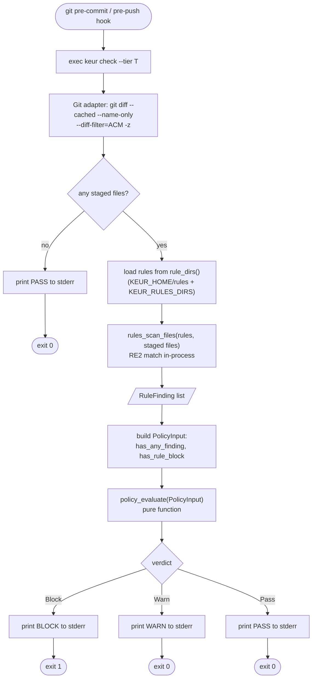
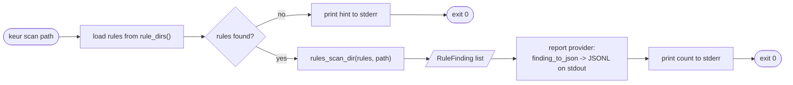

# Data flow

How a `keur check` invocation turns staged files into a verdict and an exit
code. Grounded in `src/keur/cmd/check.cpp`, `src/keur/adapters/git.cpp`,
`src/rules/rule_engine.*`, and `src/keur/util/keur_utils.h`.

## keur check (the gate)



Steps in order, as implemented:

1. The hook stub execs `keur check --tier <tier>`.
2. `check` gets the file list from a `FileSource`. In production this is
   `staged_files()`, which delegates to the Git adapter and runs
   `git diff --cached --name-only --diff-filter=ACM -z` (NUL-separated, so
   filenames with spaces survive). Tests inject a lambda instead.
3. If the list is empty, check prints PASS and returns 0.
4. `check` loads rules from every directory returned by `rule_dirs()`
   (`KEUR_HOME/rules` then each entry in `KEUR_RULES_DIRS`).
5. `rules_scan_files` runs the RE2 engine over the staged files in-process and
   returns a list of `RuleFinding`.
6. Each finding sets signals on a `PolicyInput`: `has_any_finding` for any
   finding, `has_rule_block` when a finding's `action` is `block`.
7. `policy_evaluate` maps the `PolicyInput` to a `Verdict`. It is pure: no I/O,
   no globals, table-testable.
8. The verdict is printed to stderr and mapped to an exit code: BLOCK -> 1,
   WARN -> 0, PASS -> 0.

## keur scan (inspection, no gating)



`scan` walks a directory, runs the same engine, and emits findings as JSONL on
stdout via the report provider. It always returns 0. It is inspection, not a
gate: use `keur check` for a verdict.

## Verdict policy

The decision is the pure function `policy_evaluate`:

```text
if (has_secret_block || has_rule_block) -> Block
else if (has_any_finding)               -> Warn
else                                    -> Pass
```

The thresholds `block-at` (0.85) and `warn-at` (0.50) in `keur.toml` define how
calibrated confidence maps onto these signals. `keur policy explain` prints the
resolved values.
