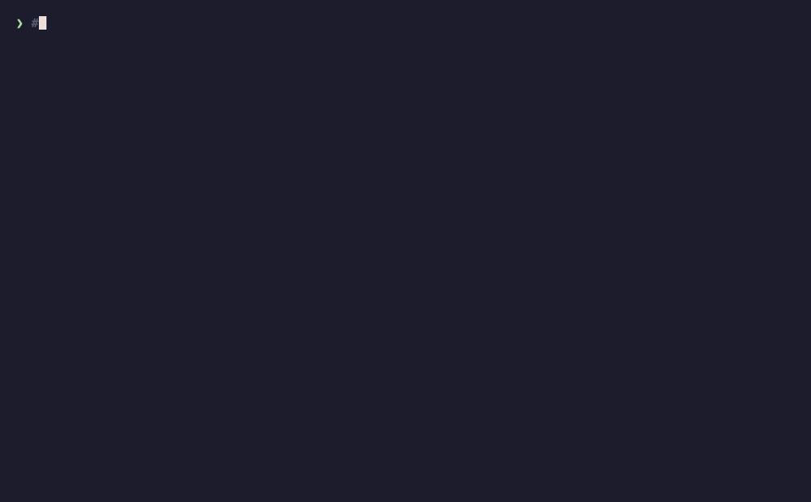

# keur demos

Short, scripted terminal recordings of keur in action. Each demo is a
[vhs](https://github.com/charmbracelet/vhs) `.tape` (the source of truth)
rendered to a GIF. Every demo follows the **AAA pattern** (Arrange / Act /
Assert), like a test: set up a clean repo, do the thing, show the expected
verdict.

Tapes carry a `@shows <id>` marker naming the concept(s) they demonstrate, so
demo coverage is measurable alongside code and test coverage (ADR-047).

## Rendering

```sh
vhs docs/demo/<name>.tape          # renders docs/demo/<name>.gif
```

Dependencies (all via Homebrew): `vhs`, `ttyd`, `ffmpeg`,
`zsh-syntax-highlighting` (coloured commands + grey comments in the recording).

## Verifying without rendering

```sh
docs/demo/run.sh <name>.tape       # run the tape's commands, show the output
docs/demo/run.sh --all             # run every demo
```

`run.sh` extracts the typed commands from a `.tape` and runs them in zsh, so you
can check a demo still produces the finding its Assert claims without rendering a
GIF.

## Demos

| Demo | Shows | Recording |
|------|-------|-----------|
| [commit-env-file](commit-env-file.tape) | `SEC-100`, `KEUR-SECRET-003` — the pre-commit hook blocks committing a `.env` file |  |
| [secret-in-code](secret-in-code.tape) | `KEUR-SEC-002` (and the overlapping secret rules) — a hardcoded password in source is flagged |  |

> TODO (see TODO.md): expand this into one page with the idea/story per demo,
> which other tool also covers it (gitleaks / trufflehog / pre-commit / semgrep),
> and the render time per demo. Add more demos (`keur:ignore` suppression,
> `keur hook`, `keur scan`, structural quality, composite, PII).

## Adding a demo

1. Copy `TEMPLATE.tape` to `docs/demo/<feature>.tape`. Keep it short: `Hide`/
   `Show` skips setup, trimmed `Sleep` turns a wait into a second or two.
2. Fill in the three AAA phases and add a `@shows <concept-id>` marker (a rule
   id, an `engine-*` id, or an ADR). One or more ids, space-separated.
3. Verify fast: `docs/demo/run.sh <feature>.tape`.
4. Render: `vhs docs/demo/<feature>.tape`, then add a row to the table above.
