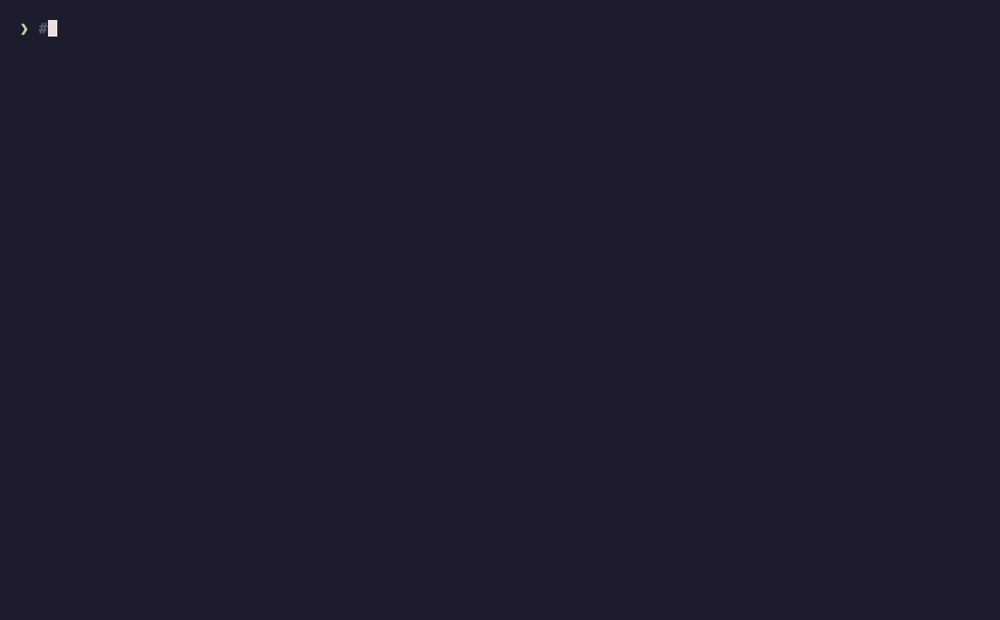
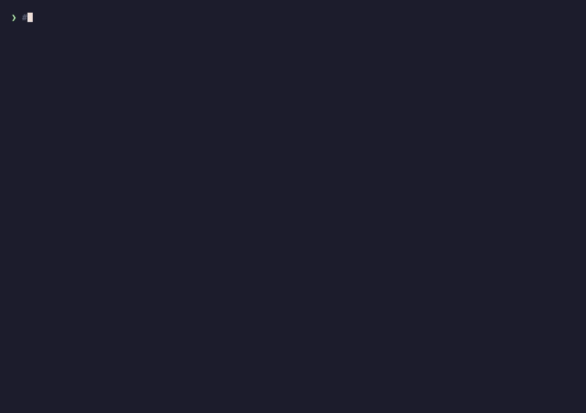
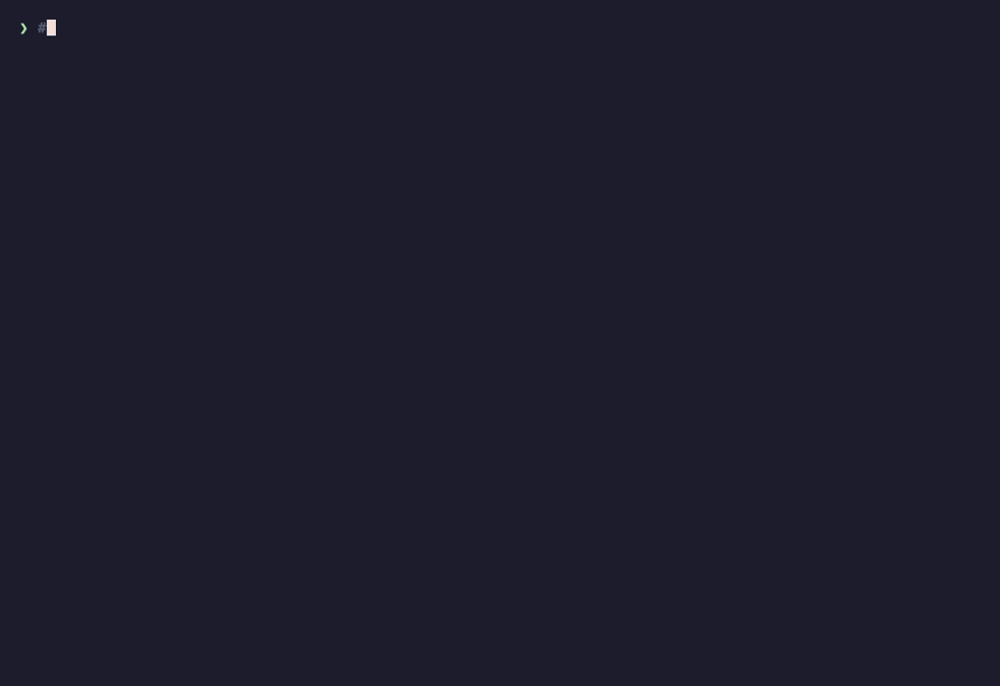
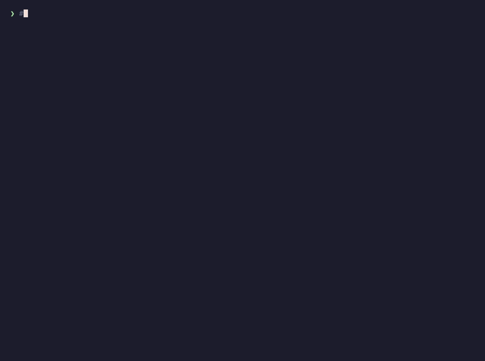

# keur demos

Short, scripted terminal recordings of keur in action. Each demo is a
[vhs](https://github.com/charmbracelet/vhs) `.tape` (the source of truth)
rendered to a GIF. Every demo follows the **AAA pattern** (Arrange / Act /
Assert), like a test: set up a clean repo, do the thing, show the expected
verdict.

Tapes carry a `@shows <id>` marker naming the concept(s) they demonstrate, so
demo coverage is measurable alongside code and test coverage (ADR-047).

## Rendering

```sh
vhs docs/demo/<name>.tape          # renders docs/demo/<name>.gif
```

Dependencies (all via Homebrew): `vhs`, `ttyd`, `ffmpeg`,
`zsh-syntax-highlighting` (coloured commands + grey comments in the recording).

## Verifying without rendering

```sh
docs/demo/run.sh <name>.tape       # run the tape's commands, show the output
docs/demo/run.sh --all             # run every demo
```

`run.sh` extracts the typed commands from a `.tape` and runs them in zsh, so you
can check a demo still produces the finding its Assert claims without rendering a
GIF.

## Demos

keur runs between git and your native tools, on patterns + structure, not deep
language semantics (see [why-keur-vs-other-tools.md](why-keur-vs-other-tools.md)).
Each demo shows something a single-language linter does not see.

### Secrets (baseline — overlaps gitleaks/trufflehog)

| Demo | Shows | Recording |
|------|-------|-----------|
| [commit-env-file](commit-env-file.tape) | `SEC-100`, `KEUR-SECRET-003` — the hook blocks committing a `.env` |  |
| [secret-in-code](secret-in-code.tape) | `KEUR-SEC-002` — a hardcoded password in source is flagged |  |

### What a language linter can't see

| Demo | Shows | Recording |
|------|-------|-----------|
| [pii-in-code](pii-in-code.tape) | `SEC-013` — PII literals (email/phone/IP), beyond secrets |  |
| [dockerfile-root](dockerfile-root.tape) | `KEUR-IAC-002` — container runs as root; ESLint/flake8 never read the Dockerfile. Full loop: warn → `keur learn` → fix |  |
| [ai-slop-fake-test](ai-slop-fake-test.tape) | `SLOP-107` — a test that asserts nothing (`toBeTruthy`); jest runs it green, keur sees it's fake |  |

### Extensibility — a custom house rule

| Demo | Shows | Recording |
|------|-------|-----------|
| [dutch-in-docs](dutch-in-docs.tape) | `DEMO-NL-001` (custom, in [rules/](rules/)) — English-only docs enforced; block → `keur learn` → fix → PASS. No linter does natural-language house rules. |  |

### Install (distribution channels, ADR-045)

| Demo | Shows | Recording |
|------|-------|-----------|
| [install-npx](install-npx.tape) | `ADR-045` — zero-install via `npx keur` (public after v0.3.0) | _(rendered post-publish)_ |
| [install-curl](install-curl.tape) | `ADR-045`, `SCA-030` — `install.sh`: download, checksum-verify, run | _(see action-ai render)_ |

Each demo has a golden-output snapshot (`<name>.out.txt`) generated by
[gen-golden.sh](gen-golden.sh), so its expected result is verifiable in-repo.
Demos run hermetically via [sandbox.sh](sandbox.sh) — see [sandbox.md](sandbox.md)
for why, and the demo tips. Roadmap + "vs other tools" per demo:
[demo-plan.md](demo-plan.md).

## Adding a demo

1. Copy `TEMPLATE.tape` to `docs/demo/<feature>.tape`. Keep it short: `Hide`/
   `Show` skips setup, trimmed `Sleep` turns a wait into a second or two.
2. Fill in the three AAA phases and add a `@shows <concept-id>` marker (a rule
   id, an `engine-*` id, or an ADR). One or more ids, space-separated.
3. Verify fast: `docs/demo/run.sh <feature>.tape`.
4. Render: `vhs docs/demo/<feature>.tape`, then add a row to the table above.
