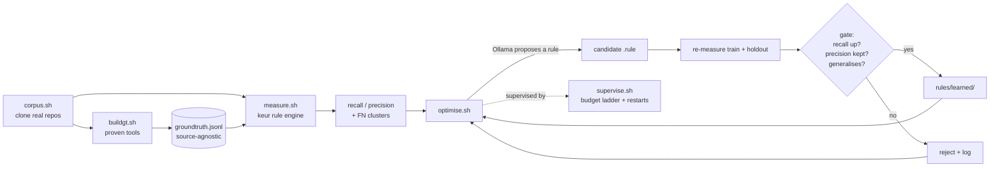

# The learning loop: training keur's rules against a proven-tool baseline

This documents the working implementation of the self-improving rule loop. The
design principles live in `evaluator.md`; this file describes what was actually
built, how to run it, and what we learned doing it.

## Idea in one sentence

Run proven security tools (gitleaks, semgrep, ...) over real repositories to
produce a ground truth, then have a local LLM propose small rule changes that
make keur's own rule engine reproduce that ground truth, with a benchmark, not
the LLM, deciding whether each change is kept.

## Pipeline



## Components

| Script | Role |
|--------|------|
| `corpus.sh`     | Clone popular / vulnerable-by-design repos into a gitignored cache. SSH clones (no keychain prompt). Size + free-disk guards. |
| `groundtruth.sh`| Run one proven tool over a path, normalise to KEUR Finding JSON. This is "libmode": keur wrapping external tools. |
| `buildgt.sh`    | Run the tools over the whole corpus, write one append-only `groundtruth.jsonl` tagged by repo. |
| `measure.sh`    | Run keur's rule engine over the corpus, join with the ground truth, report recall / precision / FN clusters. Honours the train/holdout split. |
| `optimise.sh`   | The learning loop: pick an FN, ask Ollama for the smallest rule to catch it, re-measure, gate accept/reject. |
| `preflight.sh`  | Disk + memory gate. Answers "is it safe to start another heavy iteration?" (macOS + Linux). |
| `supervise.sh`  | Babysittable background job: escalating budget ladder, preflight per phase, crash-restart with backoff. |
| `progress.sh`   | Readable dashboard: recall curve, accept/reject tally, learned-rule count. |

## The finding format is source-agnostic

Every ground-truth finding is one JSON line:

```json
{"source":"groundtruth","tool":"gitleaks","rule":"generic-api-key",
 "category":"secret","file":"path/to/file","line":54,"repo":"OWASP_NodeGoat"}
```

This is the whole reason the design scales. Today the tools are gitleaks and
semgrep. Tomorrow a Sonar / CodeRabbit / Dependabot / Renovate / AWS-security
adapter writes the same shape into the same file, and `buildgt.sh`,
`measure.sh`, `optimise.sh`, and the supervisor do not change. Adding a source
is adding one adapter. That is the "adopt the whole internet's shift-left"
direction, made concrete.

## The gate (benchmark decides, never the LLM)

A candidate rule is accepted only if ALL hold:

1. **Train recall rises** vs the current baseline.
2. **Train precision** stays at or above the floor (`KEUR_MIN_PRECISION`,
   default 0.50) and does not collapse below the previous precision.
3. **Holdout precision** stays at or above the floor: the rule must generalise
   to repos Ollama never saw, not just fit the training repos.

Ollama is the analyst that proposes; the benchmark is the referee. This is the
single most important property: the LLM cannot talk its way past the gate.

## Anti-overfit guards

The obvious failure mode: Ollama "learns" `regex: 1234` (the literal secret
value) or pastes a whole key into the pattern. That would pass train and mean
nothing. Two independent defences:

1. **Regex generalisation check** (before measuring). A candidate is rejected
   unless its regex is a *matcher*, not a *memorised value*:
   - it must contain a character class or quantifier (matches a family of
     strings, e.g. `[A-Za-z0-9]{20,}`), and
   - it must not contain a long literal alphanumeric run (>= 10 chars), which is
     almost certainly a copied secret.
   A structural pattern like `AKIA[0-9A-Z]{16}` is fine: it keeps the meaningful
   prefix but generalises the value.
2. **Held-out split** (during the gate). Repos are split train/holdout in
   `eval/corpus/split.txt`. The optimiser trains on `train`; the gate re-measures
   the candidate on `holdout`. A rule that helps train but fires as noise on
   unseen repos is rejected.

## Resource safety (safe to leave running)

- `corpus.sh`: per-repo size cap (`KEUR_CORPUS_MAX_MB`, default 100 MB) drops
  outliers; free-disk floor (`KEUR_CORPUS_MIN_FREE_MB`) aborts before the volume
  runs dry. Shallow single-branch clones keep `.git` small.
- `groundtruth.sh`: semgrep runs `--jobs 1 --max-memory --timeout
  --max-target-bytes` so one big repo cannot exhaust RAM or hang (measured peak
  ~230 MB on DVWA against a 2 GB cap).
- `preflight.sh`: checks free disk and free memory before each phase; low
  resources pause-and-retry, then stop cleanly rather than thrash the machine.
- `supervise.sh`: escalating budget ladder (default `5 25 50 50 50`), a crashed
  phase restarts with backoff up to `KEUR_MAX_RESTARTS`.
- `optimise.sh`: convergence stops after `KEUR_MAX_STALL` consecutive rejects so
  an unlearnable FN cluster does not burn hours.

Note on memory: the Ollama model (qwen2.5-coder:14b) is the dominant RAM cost
(~10 GB loaded on a 32 GB machine). Tools run sequentially, never in parallel
with the model, on purpose.

## Running it

```sh
cd ~/git/hub/keur

# 1. build the corpus (SSH clones; guarded)
eval/corpus.sh clone

# 2. assign a train/holdout split (repo <TAB> train|holdout) in
#    eval/corpus/split.txt   (unlisted repos default to train)

# 3. build the ground truth from the proven tools
eval/buildgt.sh                 # all tools;  or --tool gitleaks for speed
eval/buildgt.sh --stats

# 4a. one measurement (no learning)
KEUR_RULES_DIRS=$PWD/rules eval/measure.sh
KEUR_RULES_DIRS=$PWD/rules eval/measure.sh --fn     # what keur misses

# 4b. a few learning iterations by hand
eval/optimise.sh iterate 5

# 5. the babysittable multi-hour run
KEUR_LOOP_CMD="$PWD/eval/optimise.sh iterate" \
KEUR_PHASES="5 25 50 50 50 50" \
  eval/supervise.sh start

# watch it (other shells)
eval/supervise.sh tail          # raw supervisor log
eval/progress.sh watch          # recall curve dashboard
eval/supervise.sh status        # phase + last log
eval/supervise.sh stop          # graceful stop
```

Accepted rules land in `rules/learned/` (gitignored until reviewed). Every
iteration appends a compact record to `eval/history/optimiser.jsonl`.

## What we learned

1. **File-level matching does not work across detection mechanisms.** gitleaks
   detects secrets by entropy/context; keur's rules are keyword regex. Both find
   real secrets, but rarely in the *same file*. A strict file+category join
   pinned recall at 0.20 even for a correct rule. We switched to **repo+category**
   matching (Option A): "does keur reproduce the tool's category coverage in this
   repo?" With that, recall moves and the loop learns. The right question was not
   "same finding" but "same coverage".

2. **The LLM will overfit if you let it.** Without the guards, the cheapest way
   to pass the benchmark is to memorise the training value. The generalisation
   regex check plus the held-out split are not optional extras; they are what
   makes a learned rule worth anything.

3. **The benchmark must own the decision.** Early prompts asked Ollama for a
   confidence or a self-assessment. Ignore it. The only signals that matter are
   the measured recall/precision on train and holdout. Confidence (evidence
   strength) and "how good the LLM thinks its patch is" are different concepts
   and must not be merged.

4. **Proven tools as ground truth is an assumption, not truth.** We currently
   treat gitleaks/semgrep as always correct. They are not (they have their own
   FP/FN). This is a deliberate starting point: a proven-tool baseline beats no
   baseline. The multi-source design is the way out: where independent sources
   agree, confidence rises; where they disagree, that is a review candidate and a
   corpus-improvement signal, not a fact.

5. **The loop currently fixates on one FN cluster.** FN targeting always picks
   the first missed item, so the loop keeps proposing rules for the same hard
   case (a payload-list README full of example keys that is genuinely hard to
   match without noise). The convergence guard stops this from wasting hours, but
   the hours are only productive once FN targeting *rotates* across different
   missed clusters. That is the next improvement (see below).

## Known limitations / next steps

- **Rotate FN targeting.** Instead of always the first FN, cycle through distinct
  missed clusters (by category, by repo) so each iteration attacks something new.
- **semgrep coverage.** `p/default` produced 0 findings in the first runs
  (registry/timeout). Wire a local ruleset so sqli/cmdi/sast categories enter the
  ground truth, not just secrets.
- **More sources.** Add adapters for Sonar, CodeRabbit, Dependabot, Renovate,
  AWS security. Each is one function in `groundtruth.sh` emitting the same JSON.
- **Two-layer memory in the prompt.** Feed Ollama a compact history summary
  (accepted/rejected changes, known failure modes) rather than re-deriving from
  scratch each iteration (see evaluator.md).
- **Larger corpus.** Currently ~6 usable repos after the size cap; scale toward
  50 for a more robust signal.
