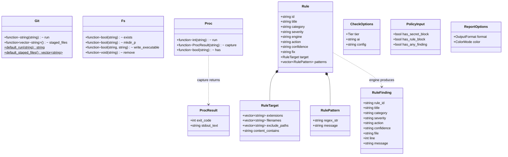
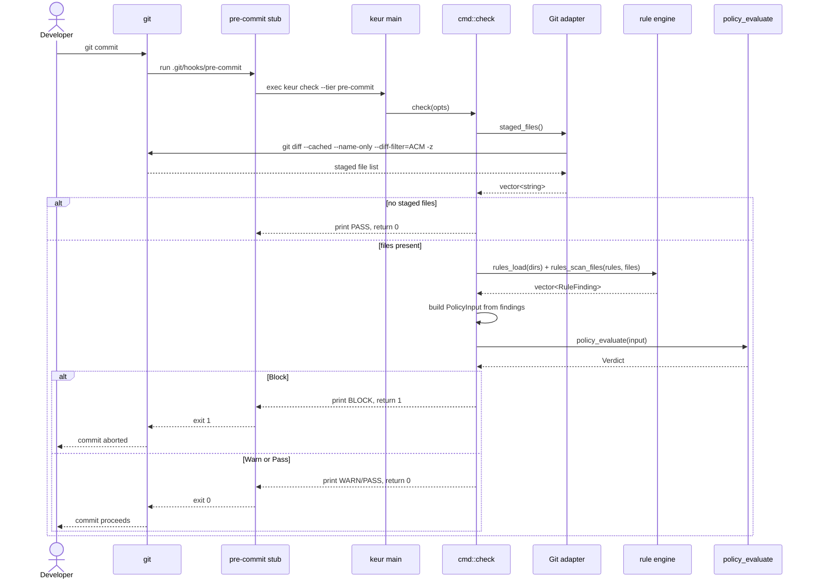
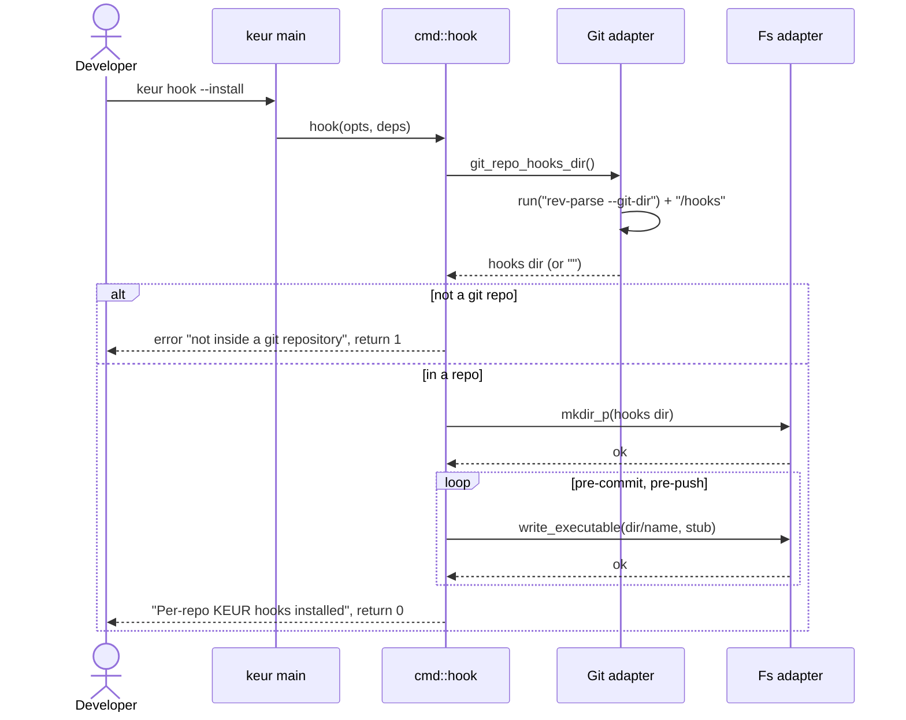

# Diagrams

Class and sequence diagrams for keur, grounded in the headers and
implementations under `src/keur/` and `src/rules/`.

## Class diagram: core types

Fields and their types are taken from `src/keur/adapters/{git,fs,proc}.h`,
`src/rules/rule_engine.h`, `src/keur/cmd/check.h`, and
`src/keur/report/report.h`. Adapter members are `std::function` seams defaulted
to the real implementation.



Notes:

- `PolicyInput` is consumed by the pure `policy_evaluate(const PolicyInput&) ->
  Verdict`. `has_secret_block` and `has_rule_block` both force BLOCK.
- `RuleFinding` is serialised by the report provider (`finding_to_json`), which
  is the single definition of keur's finding JSON.
- `CheckOptions` uses `Tier` (`PreCommit` / `PrePush`). `ReportOptions` uses
  `OutputFormat` (`Jsonl` / `Compact` / `Verbose`) and `ColorMode` (`Auto` /
  `Always` / `Never`).

## Sequence: keur check on commit

Grounded in `src/keur/main.cpp`, `src/keur/cmd/check.cpp`, and
`src/keur/adapters/git.cpp`.



## Sequence: keur hook --install

Grounded in `src/keur/cmd/hook.cpp` and `src/keur/adapters/{git,fs}.cpp`.



The stub written by `write_executable` is minimal and contains no logic:

```sh
#!/bin/sh
exec keur check --tier pre-commit
```

`--global` follows the same shape but targets `global_hooks_dir()`
(`$XDG_CONFIG_HOME/git/hooks`) and then sets `core.hooksPath` through the Proc
adapter, unless it is already set to a different directory.
